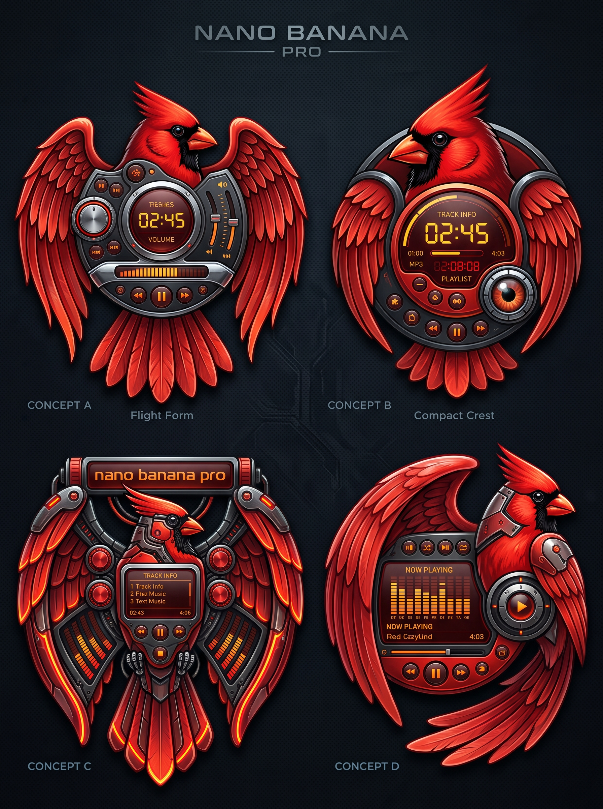

# Design references

## Redbird shaped-player concepts (October 2026)

AI-generated concept sheet (Nano Banana Pro), made by Eddie. **Reference only —
not production art and not shipped in the app.** The generator's name on the sheet
is just its label, not part of our branding.

**Eddie's picks: Concept A ("Flight Form") and Concept D.**

- **Concept A — Flight Form.** Cardinal with wings spread; the player body sits on
  the chest — round time display in the center, transport row along the bottom,
  volume/balance sliders on the right, a knob on the left, a level meter below the
  display. Symmetrical, reads clearly at a glance. Likely the easier first shaped skin.
- **Concept D.** Cardinal perched to the right, one wing sweeping up and around a
  rectangular "Now Playing" screen with a spectrum display, track title and time,
  seek bar, transport row, and a large round play button set into the bird's side.
  Asymmetrical and more dramatic; the screen area is a natural home for the
  MilkDrop visuals.

### Notes for building from these

- They are **shaped surfaces** (the Sonique idea): the outline is the bird; the
  controls are the same Plumage controls in a new arrangement. See ROADMAP Milestone 4.
- All text on the real skin (times, track names, labels) is **live text drawn by the
  app**, not painted into the artwork. The garbled lettering in the concepts is a
  generator artifact.
- Likely construction: the bird artwork as image layers, the outline as a mask/hit
  shape, and real HTML controls positioned over it — so the skin stays clickable,
  keyboard-operable and screen-reader-labeled. The semantic control bar still exists
  underneath regardless of skin.
- Final artwork will need to be redrawn or cleaned up as original art at proper
  resolution (with layers for buttons' normal/hover/pressed/focus states).
- Check contrast of the orange-on-dark display text against AA.
